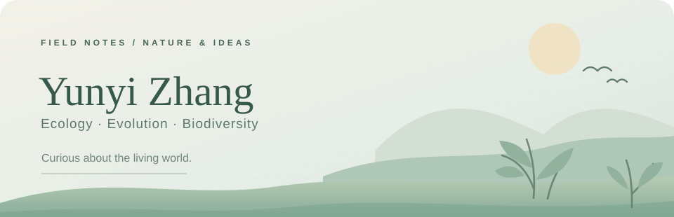
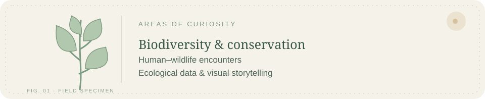
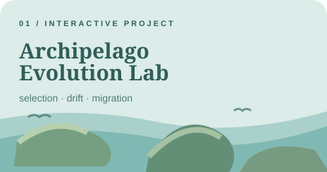
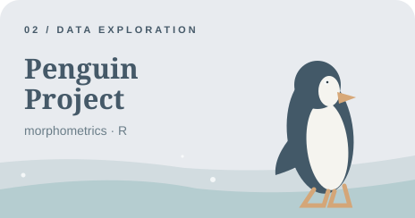
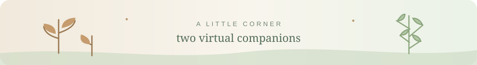
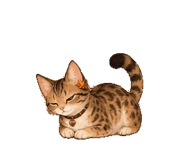
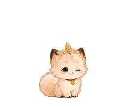

  
  

    University of Edinburgh · MSc Ecology, Evolution and Biodiversity 
    University of Liverpool / Xi'an Jiaotong-Liverpool University · BSc (Hons) Environmental Science
  

  

### 01 / A little about me

<table>
  <tr>
    <td width="58%" valign="top">
      
I'm curious about <b>biodiversity conservation</b>, <b>human–wildlife encounters</b>, and the many ways we connect with the natural world.

      
I enjoy turning ecological questions into research, visual stories, and small interactive experiments.

      
我关注生物多样性保护、人与野生动物的相遇，以及人与自然之间的联系。也喜欢用数据与交互工具，让生态学问题变得更直观。

    </td>
    <td width="42%" valign="top">
      
<b>Field notes</b> 🌿

      
🐾 Human–nature connections 
      🌱 Biodiversity &amp; conservation 
      📊 Ecological data &amp; visualisation 
      🧭 Research methods

      
<code>R</code> · <code>Python</code> · <code>GIS</code>

    </td>
  </tr>
</table>

  

### 02 / Little things I've made

<table>
  <tr>
    <td width="50%" align="center" valign="top">
      
      
<b><a href="https://github.com/yunyizhang2202/Archipelago-Evolution-Lab">Archipelago Evolution Lab ↗</a></b>

      
A small interactive space for exploring natural selection, genetic drift, and migration among islands.

    </td>
    <td width="50%" align="center" valign="top">
      
      
<b><a href="https://github.com/yunyizhang2202/penguin_project">Penguin Project ↗</a></b>

      
A little R exploration of Palmer penguins and their morphometric data.

    </td>
  </tr>
</table>

### 03 / A small corner 🐾

  
  
我的两只虚拟宠物 · 阿栗和小麦

<table align="center">
  <tr>
    <td align="center" width="218">
       
      <b>阿栗 · Ali</b> 
    </td>
    <td align="center" width="218">
       
      <b>小麦 · Xiaomai</b> 
    </td>
  </tr>
</table>

   
  ✦ A little field notebook for nature, ideas, and things still growing. ✦

