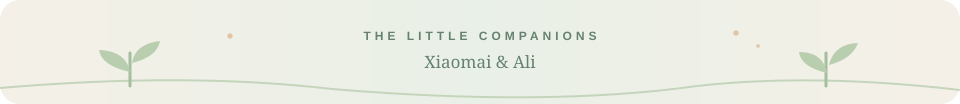
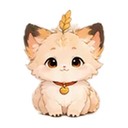

  
  
MSc Ecology, Evolution and Biodiversity · University of Edinburgh 
  BSc (Hons) Environmental Science · University of Liverpool / Xi'an Jiaotong-Liverpool University

### 01 / Hello, I'm Yunyi

I'm interested in **biodiversity conservation**, **human–wildlife encounters**, and the ways people connect with nature. I enjoy exploring ecological questions through research, data and small interactive projects.

你好！我关注生物多样性保护、人与野生动物的相遇，以及人与自然之间的联系。也喜欢用数据和交互式小工具，让复杂的生态问题更容易理解。

  
  
Currently exploring with R · Python · GIS

### 02 / Selected projects

<table>
  <tr>
    <td width="50%" valign="top" align="center">
      
      
<b><a href="https://github.com/yunyizhang2202/Archipelago-Evolution-Lab">Explore the islands ↗</a></b> An interactive evolution simulator about natural selection, genetic drift and migration.

    </td>
    <td width="50%" valign="top" align="center">
      
      
<b><a href="https://github.com/yunyizhang2202/penguin_project">Meet the penguins ↗</a></b> Exploring Palmer penguins' morphometric data with R.

    </td>
  </tr>
</table>

### 03 / A little corner 🐾

  
  
My two virtual pets · 我的两只虚拟宠物

<table align="center">
  <tr>
    <td align="center" width="160">
       
      <b>小麦 · Xiaomai</b>
    </td>
    <td align="center" width="160">
       
      <b>阿栗 · Ali</b> 
      portrait coming soon
    </td>
  </tr>
</table>

✦ A small notebook of nature, ideas and things in progress. ✦

